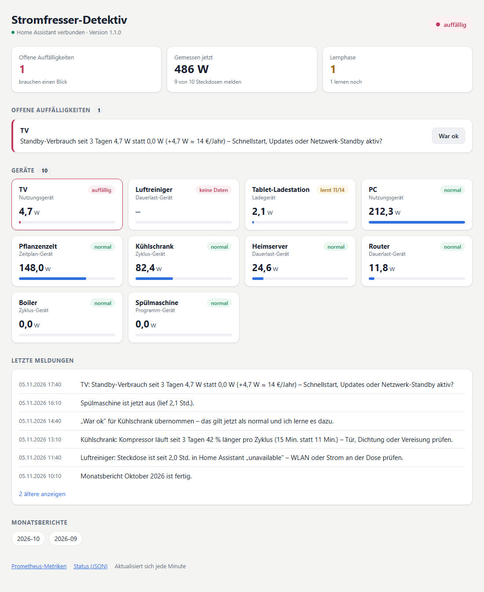

# Power Hog Detective (Stromfresser-Detektiv)

*English version: [README.md](README.md)*

Der Detektiv lernt für jedes Gerät an einer Messsteckdose in Home Assistant das normale Verbrauchsmuster. Er meldet ungewöhnliches Verhalten **mit Erklärung in Klartext**, zum Beispiel:

> Kühlschrank: Kompressor läuft seit 3 Tagen 42 % länger pro Zyklus (15 Min. statt 11 Min.) – Tür, Dichtung oder Vereisung prüfen.

> Nächtliche Grundlast seit Sonntag +36 W, keiner Steckdose zuzuordnen (136 W statt 100 W ohne Messsteckdose, ≈ 108 €/Jahr) – Geräte ohne Messsteckdose prüfen …

> Spülmaschine läuft seit 5,0 Std. ununterbrochen (eingestellte Grenze 5,0 Std.) – vergessen auszuschalten?

Alles auf einen Blick in einer kleinen Weboberfläche ([mehr](#weboberfläche-und-http-api)):



*Demodaten, kein echter Haushalt.*

Meldungen, Weboberfläche, Berichte und die Zustände der HA-Sensoren gibt es auf **Deutsch und Englisch**. Für Deutsch stellt man in der Konfiguration `language: de` ein; Standard ist Englisch.

Der Detektiv **liest nur**. Er schaltet keine Geräte:
- Technisch gesperrt sind alle Home-Assistant-Dienste außer `notify.*` und `persistent_notification.*`. Ein Test prüft das.
- Er schreibt nur seine eigenen Sensoren `sensor.<präfix>_*`.
- Einmalig legt er ein Feedback-Skript `script.<präfix>_war_ok` an.

---

## Inhalt

1. [Was er erkennt](#was-er-erkennt)
2. [Wie er lernt](#wie-er-lernt)
3. [Voraussetzungen](#voraussetzungen)
4. [Installation](#installation)
5. [Secrets](#secrets)
6. [Konfiguration](#konfiguration)
7. [Bedienung: Meldungen, „War ok“, CLI](#bedienung)
8. [Weboberfläche und HTTP-API](#weboberfläche-und-http-api)
9. [Home Assistant, Prometheus, Grafana](#home-assistant-prometheus-grafana)
10. [Monatsbericht](#monatsbericht)
11. [Daten und SD-Karte](#daten-und-sd-karte)
12. [Tests und Abnahme-Szenarien](#tests)
13. [Fehlersuche](#fehlersuche)
14. [Grenzen](#grenzen)

---

## Was er erkennt

| Gerätetyp (`type`) | Beispiele | Gelernte Merkmale (pro Tag) | Typische Meldung |
|---|---|---|---|
| `cycle` (Zyklus) | Kühlschrank, Boiler | Zyklusdauer, Pause, Zyklen/Tag, Laufzeitanteil, kWh | Zyklen länger → Tür/Dichtung/Vereisung; Boiler heizt öfter nach → Warmwasser, tropfender Hahn |
| `continuous` (Dauerlast) | Router, Server, Raspberry Pi | Grundlast (Median) | Grundlast +9 W seit Dienstag |
| `program` (Programm) | Spülmaschine, Waschmaschine | erkennt Programme (Dauer + Energie), Läufe, Standby | Programm A braucht seit 2 Läufen 50 % mehr Energie → Heizstab verkalkt? |
| `usage` (Nutzung) | PC, TV | Standby-Leistung, Stunden an | Standby 4,7 W statt 0 W → Schnellstart/Updates? |
| `charger` (Ladegerät) | Tablet-Station | Leistung ohne Ladevorgang, Ladungen | zieht ohne Ladevorgang dauerhaft … |
| `schedule` (Zeitplan) | Growbox, Aquarium | Einschaltzeit, Leistung im Betrieb | schaltet um 07:00 statt 06:00 ein → Zeitschaltuhr? |
| Haus | Hauszähler (optional) | nächtliche Grundlast, Anteil ohne Messsteckdose, große Lastspitzen (Durchlauferhitzer) | Nächtliche Grundlast seit Sonntag +36 W, keiner Steckdose zuzuordnen |

**Live-Prüfungen**, alle 30 Sekunden:

- **Läuft ungewöhnlich lange** (Bügeleisen-Fall). Die Grenze ist entweder `max_runtime` je Gerät oder gelernt (längster üblicher Lauf × 1,2 bzw. 99-%-Wert × 1,5). Beim Kühlschrank heißt das: Kompressor läuft ohne Pause → Tür offen?
- **Verbraucht plötzlich nichts mehr**, obwohl die Steckdose an ist, also ein möglicher Defekt:
  - Dauerlast-Geräte: nach 15 Min.,
  - Zyklus-Geräte: wenn die übliche längste Pause dreifach überschritten ist.

  Eine absichtlich ausgeschaltete Steckdose löst keine Meldung aus.

**Selbstüberwachung:**

- **Steckdose nicht erreichbar** (`unavailable`/`unknown` in HA, Verbindung weg): Push nach 30 Min.
- **Steckdose liefert keine frischen Werte**, ist aber verbunden: steht nur still in der Weboberfläche. Selten genutzte Geräte (z. B. die Spülmaschine) würden sonst ständig melden. Mit `notify_no_data: true` kommt auch dafür ein Push.
- **Home Assistant ist weg:** Die Meldung wird gepuffert und nach der Rückkehr zugestellt.
- **Entitäts-ID umbenannt:** erkannt über die `unique_id`, automatisch weiterverfolgt und gemeldet.
- **Entität fehlt ganz.**
- **Hausdaten fehlen oder sind unplausibel** (Haus < Summe der Steckdosen).

**Lebenszeichen:** HA aktualisiert `last_reported` beim Leistungssensor nicht, solange der Wert gleich bleibt. Der Detektiv beobachtet deshalb einen Nachbarsensor desselben Geräts (meist die Spannung). Diesen ermittelt er automatisch aus der Registry.

## Wie er lernt

- **Mindestens 14 Tage** Lernphase (`learning.min_days`), vorher gibt es keine Vergleichs-Meldungen.
- **Gleitendes Fenster von 28 Tagen** (`learning.window_days`): Normal ist der Median der letzten 28 gültigen Tage. Langsame, gewollte Änderungen wandern so ins Normal und lösen keinen Alarm aus.
- **Rauschunterdrückung:** Ein Tag gilt als auffällig, wenn alles davon zutrifft:
  - mindestens 25 % Abweichung vom Normal,
  - mindestens 3 robuste Standardabweichungen (MAD),
  - eine Mindestgröße (z. B. 2 Min. Zyklusdauer, 3 W Grundlast).

  Gemeldet wird erst nach **3 Tagen in Folge** (`detection.stable_days`). Harmlose Richtungen (weniger Verbrauch, längere Pausen) melden nichts.
- **Neues Normal:**
  - Nach „War ok“ sofort: Der Vergleich startet am Beginn der Abweichung neu und braucht 3 Tage.
  - Ohne Feedback automatisch, wenn eine Abweichung 14 Tage anhält, mit kurzem Hinweis.
- **Entwarnung:** Nach 2 normalen Tagen gilt eine Auffälligkeit als erledigt. Auf Wunsch kommt dann „… ist wieder normal“.
- **Vorlernen aus der Vergangenheit:** `sfd prelearn` nutzt drei Quellen:
  - 35 Tage aus Prometheus über den Prometheus-Export von HA, alle 15 s, genau genug für Kompressorzyklen,
  - ersatzweise den HA-Recorder,
  - die stündliche HA-Langzeitstatistik für die Berichte.

  Alte Entitäts-IDs (vor einer Umbenennung) stehen je Gerät unter `history:`.

## Voraussetzungen

- Home Assistant mit einem Leistungssensor in W je Messsteckdose (getestet mit TP-Link/Tapo P110 über die Integration `tplink`). Ein Schalter je Steckdose ist optional; mit ihm unterscheidet der Detektiv „aus“ von „defekt“.
- Ein notify-Dienst, z. B. die Companion-App `notify.mobile_app_<handy>` (für den Knopf „War ok“).
- Docker mit Compose-Plugin (getestet auf einem Raspberry Pi 4, arm64).
- Optional:
  - Prometheus, der HA abfragt (Integration `prometheus:`), fürs Vorlernen,
  - Grafana,
  - ein Hauszähler in HA (IR-Lesekopf am Stromzähler, Shelly 3EM, …).

## Installation

```bash
git clone https://github.com/Zedas030/power-hog-detective.git /opt/power-hog-detective
cd /opt/power-hog-detective
cp config/config.example.yaml config/config.yaml   # anpassen, language: de setzen, siehe unten
cp .env.example .env && chmod 600 .env              # Token eintragen, siehe "Secrets"
mkdir -p data && sudo chown 10001:10001 data         # der Container läuft als Benutzer 10001
docker build --target test -t power-hog-detective:test .        # führt alle Tests aus
docker compose run --rm power-hog-detective selftest            # Verbindung + Entitäten prüfen
docker compose run --rm power-hog-detective prelearn            # Historie einlesen (ca. 5 Min.)
docker compose up -d --build
```

Was die `docker-compose.yml` festlegt:

- Autostart (`restart: unless-stopped`).
- Ressourcenlimits: 256 MB RAM, 0,5 CPU, 64 Prozesse.
- Schreibgeschütztes Dateisystem, keine Capabilities.
- Log-Rotation: 3 × 10 MB.
- Host-Netz, damit der Container HA und Prometheus unter `127.0.0.1` erreicht.
- Healthcheck auf `/health`.

Danach die Weboberfläche unter `http://<host>:8101/` öffnen, siehe [Weboberfläche und HTTP-API](#weboberfläche-und-http-api).

Update: `git pull && docker compose up -d --build`. Daten und Gelerntes bleiben in `data/`.

## Secrets

| Was | Wo | Hinweis |
|---|---|---|
| Home-Assistant-Token | `.env` neben `docker-compose.yml` → `HA_TOKEN=…` | Datei `chmod 600`, nie in `config.yaml`, nie committen |

**Token anlegen bzw. tauschen (rotieren):**

1. In HA: unten links Profil → Reiter *Sicherheit* → *Langlebige Zugriffstoken* → *Token erstellen*, Name z. B. `power-hog-detective`.
2. Den Token in `.env` hinter `HA_TOKEN=` eintragen (Datei bleibt `chmod 600`).
3. `docker compose up -d` (der Container liest die `.env` beim Start).
4. Prüfen: `docker compose exec power-hog-detective python -m sfd selftest`.
5. Den alten Token in HA unter *Langlebige Zugriffstoken* löschen.

Der Token braucht Lesezugriff auf Zustände, Registry, Verlauf und Statistik und muss `notify` aufrufen dürfen. HA kennt keine rein lesenden Token; die Sperre gegen Schalten steckt im Detektiv selbst.

## Konfiguration

Alles steht kommentiert in [`config/config.example.yaml`](config/config.example.yaml). Die Schlüssel sind englisch; die deutschen Schlüssel älterer Versionen (`geraete`, `typ: zyklus`, `leistung` …) funktionieren weiter. Die wichtigsten Stellen:

```yaml
language: de                          # de | en
home_assistant:
  notify: notify.mobile_app_handy     # Meldungen mit Knopf "War ok"
  sensor_prefix: stromfresser         # eigene Sensoren sensor.stromfresser_*
prices:
  import_eur_kwh: 0.34
  export_eur_kwh: 0.00
devices:
  kuehlschrank:
    name: Kühlschrank
    type: cycle                       # cycle | continuous | program | usage | charger | schedule
    profile: fridge                   # passende Tipps in den Meldungen
    power: sensor.kuehlschrank_leistung
    switch: switch.kuehlschrank       # damit "aus" nicht als Defekt zählt
  buegeleisen:
    name: Bügeleisen
    type: usage
    power: sensor.buegeleisen_leistung
    max_runtime: 45m                  # Bügeleisen-Fall
```

Ein neues Gerät eintragen und `docker compose restart` ausführen. Es lernt dann ab sofort; mit `prelearn` auch rückwirkend.

**Hauszähler:** Unter `house:` einen Leistungssensor des ganzen Hauses eintragen, z. B. von einem IR-Lesekopf am Stromzähler oder einem Shelly 3EM. Damit laufen:
- nächtliche Grundlast des Hauses,
- nicht zugeordnete Last,
- Netz/Solar-Anteil,
- die Schätzung des Durchlauferhitzers.

Ohne Zähler ruht dieser Teil. Der Solaranteil wird dann aus `solar_into_house` geschätzt (z. B. Ausgangsleistung eines Speichers oder Mikro-Wechselrichters mit Nulleinspeisung).

## Bedienung

**Meldungen** kommen über den eingestellten `notify`-Dienst. Am Handy hat jede Auffälligkeit den Knopf **„War ok“**.

**„War ok“ (Feedback)** geht auf vier Wegen. Der Detektiv übernimmt das neue Verhalten dann als normal.

| Weg | So geht's |
|---|---|
| Handy | Knopf „War ok“ in der Benachrichtigung |
| HA-Aktion | `script.<präfix>_war_ok` mit `geraet: Kühlschrank` (Name oder Schlüssel, `Haus` für das Haus) und optional `notiz`. Nutzbar in Dashboards und Automationen. Alternativ das Ereignis `<präfix>_feedback` selbst auslösen. |
| Weboberfläche | Knopf „War ok“ neben der Auffälligkeit |
| CLI | `docker compose exec power-hog-detective python -m sfd ok <ID oder Gerät> --note "…"` |

Was „War ok“ bewirkt:

- **Tagesmerkmale:** Das neue Normal gilt ab Beginn der Abweichung.
- **Programme:** Die abweichenden Läufe werden zum Programm.
- **„Läuft zu lange“:** Die Grenze steigt auf die beobachtete Laufzeit × 1,5.
- **Ausfälle** („keine Werte“, „0 W“): stumm, bis das Problem vorbei ist. Danach kann es wieder melden.

**CLI** (im Container: `docker compose exec power-hog-detective python -m sfd …`). Die deutschen Befehlsnamen (`vorlernen`, `bericht`, `szenario`, `meldungen`, `selbsttest`) funktionieren auch.

| Befehl | Zweck |
|---|---|
| `status` | Lernfortschritt, Merkmale von gestern, offene Auffälligkeiten |
| `findings` | letzte Auffälligkeiten mit ID und Zustand |
| `ok <ID/Gerät>` | Feedback „War ok“ |
| `prelearn [--days 35] [--notify]` | aus Prometheus/HA-Historie lernen |
| `report [--month 2026-10] [--send]` | Monatsbericht erzeugen (und Kurzfassung schicken) |
| `scenario compressor\|baseload\|runtime\|all [--send]` | Abnahme-Szenarien, siehe unten |
| `import-statistics` | HA-Stundenstatistik nachladen |
| `selftest` | Token und Entitäten prüfen |

## Weboberfläche und HTTP-API

`http://<host>:8101/` ist eine Übersicht für den schnellen Blick, am Rechner oder auf dem Handy:

- **Kopf:** Gesamtstatus (`ok`, `lernt`, `auffällig`, `keine Verbindung`) und ob Home Assistant verbunden ist.
- **Kennzahlen:** offene Auffälligkeiten, gerade gemessene Leistung über alle Steckdosen (und wie viele davon
  melden), Geräte in der Lernphase. Mit Hauszähler kommt eine Kachel für das Haus dazu.
- **Offene Auffälligkeiten** als Karten mit Gerätename und Knopf **„War ok“**.
- **Geräte** als Kacheln mit aktueller Leistung, einem Balken im Vergleich zum stärksten Gerät und dem Zustand
  (`normal`, `lernt n/14`, `auffällig`, `keine Daten`). Probleme stehen oben, danach geht es nach Leistung.
- **Letzte Meldungen** als Zeitleiste: die neuesten 6, bis zu 30 weitere zum Aufklappen.
- **Monatsberichte** als Links.

Die Seite folgt der Hell/Dunkel-Einstellung des Systems, zeigt auf dem Handy zwei Spalten und lädt sich jede
Minute neu, solange der Tab sichtbar ist. Sie lädt nichts aus dem Internet.

**HTTP-Endpunkte** (gleicher Port):

| Pfad | Zweck |
|---|---|
| `GET /` | die Übersicht oben |
| `GET /berichte/bericht-JJJJ-MM.html` | ein Monatsbericht (auch unter `/reports/…`) |
| `GET /api/status` | JSON: `status`, Lernstand je Gerät, offene Auffälligkeiten mit `id`, `device`, `message`, `state`; bei `language: de` zusätzlich die deutschen Schlüssel `lernfortschritt` und `offen` |
| `POST /api/feedback` | „War ok“ aus eigenen Werkzeugen: JSON `{"target": "<ID oder Gerät>"}`, Antwort `{"accepted": [IDs]}` |
| `GET /metrics` | Prometheus-Metriken, siehe unten |
| `GET /health` | JSON `ok`, `ha_connected`, `version`, `uptime_s` (für den Docker-Healthcheck) |

Beispiel: `curl -X POST -H 'Content-Type: application/json' -d '{"target": "TV"}' http://<host>:8101/api/feedback`

**Es gibt keine Anmeldung.** Wer den Port erreicht, sieht die Geräte und kann „War ok“ drücken. Port 8101 im
LAN oder VPN lassen und nicht am Router freigeben.

## Home Assistant, Prometheus, Grafana

**HA-Sensoren** werden jede Minute und nach jedem HA-Neustart neu gesetzt. Die Namen gelten für `language: de`.

- `sensor.<präfix>_status`: `ok` / `lernt` / `auffällig` / `keine Verbindung`; Attribut `offene_meldungen`.
- `sensor.<präfix>_offene_auffaelligkeiten`: Anzahl.
- `sensor.<präfix>_<gerät>`: `normal` / `lernt` / `auffällig` / `keine Daten`. Attribute: Gerätetyp, Lerntage, aktuelle Meldung, Merkmale von gestern.
- Mit Hauszähler zusätzlich `sensor.<präfix>_nachtgrundlast` und `sensor.<präfix>_unzugeordnete_grundlast`.

**Prometheus:** `http://<host>:8101/metrics`. Scrape-Eintrag:

```yaml
  - job_name: power_hog_detective
    scrape_interval: 60s
    static_configs:
      - targets: ['localhost:8101']
```

Metriken (`sfd_…`):

- `device_power_watts`
- `device_last_value_age_seconds`
- `device_available`
- `device_running_seconds`
- `feature_value` / `feature_baseline` (Merkmal gegen gelerntes Normal)
- `learning_days`
- `anomalies_open`
- `house_night_base_watts`
- `ha_connected`
- `outbox_pending`
- `db_size_bytes`

**Grafana:** [`grafana/power-hog-detective.json`](grafana/power-hog-detective.json) importieren oder in einen Provisioning-Ordner legen. Die Datenquelle ist eine Variable. Deutsche Titel: `python grafana/make_dashboard.py --lang de` erzeugt `stromfresser-detektiv.de.json`.

## Monatsbericht

Am 1. jedes Monats um 07:00 (einstellbar) schreibt der Detektiv den Bericht nach `data/reports/` (mit `language: de` heißt die Datei `bericht-JJJJ-MM.html`). Er ist auch in der Weboberfläche verlinkt, und eine Kurzfassung geht per `notify` raus. Der Bericht enthält:

- **Verbrauch und Kosten pro Gerät.** Kosten = kWh × Netzanteil der jeweiligen Stunde × Strompreis.
- **Anteil aus Solar/Batterie gegenüber Netz:** mit Hauszähler gemessen, sonst geschätzt.
- **Entwicklung der Grundlast** im Monat.
- **Top-5-Sparpotenziale** mit €/Jahr und Rechenweg. Mögliche Posten:
  - Standby abschalten,
  - Nutzungsgeräte, die nachts laufen,
  - Kühlgerät über einem Referenzwert,
  - Lasten in Sonnenstunden verlegen,
  - nicht zugeordnete Grundlast,
  - Durchlauferhitzer.
- **Auffälligkeiten des Monats und Hinweise zur Datenlage.**

Von Hand: `python -m sfd report --month 2026-10`.

## Daten und SD-Karte

SQLite in `data/` (WAL-Modus). Messwerte werden gesammelt und einmal pro Minute in einem Rutsch geschrieben.

Täglich um 00:20 läuft die Tagesauswertung, danach wird verdichtet:

| Stufe | Aufbewahrung (einstellbar unter `storage:`) |
|---|---|
| Rohwerte | 14 Tage |
| Minutenmittel | 90 Tage |
| Viertelstundenmittel | 2 Jahre |
| Stundenenergie, Tagesmerkmale, Läufe, Meldungen | dauerhaft (wenige MB pro Jahr) |

Größe nach 35 Tagen Vorlernen mit 12 Steckdosen: etwa 85 MB, danach weitgehend stabil.

## Tests

```bash
docker build --target test -t power-hog-detective:test .     # Unit- und End-to-End-Tests
pip install -r requirements.txt -r requirements-dev.txt && python -m pytest -q tests/
```

Die Testdateien:

- **`tests/test_detection.py`:** Erkennungslogik mit synthetischen Verbrauchsdaten. Abgedeckt sind Kompressorzyklen, Grundlast, Laufzeit, Defekt, Ausfall, Feedback, langsame Drift, Programme, Zeitpläne, Plausibilität und Stummschaltung.
- **`tests/test_report.py`:** Monatsbericht und Metriken.
- **`tests/test_english.py`:** englische Texte, englische und deutsche Konfigurationsschlüssel.
- **`tests/test_e2e.py`:** der echte Dienst gegen ein nachgebautes Home Assistant (WebSocket + REST). Abgedeckt sind:
  - Meldung mit Knopf, Knopf-Rückmeldung,
  - Umbenennung einer Entität,
  - Steckdose verstummt, Lebenszeichen über die Spannung,
  - Hausdaten weg, Feedback über das HA-Ereignis,
  - HA-Ausfall, Web, Metriken,
  - es werden nur `notify`-Dienste aufgerufen.

**Abnahme-Szenarien auf den echten Lerndaten.** Sie laufen auf einer Kopie der Datenbank; mit `--send` kommen sie als `[TEST]` aufs Handy.

```bash
docker compose exec power-hog-detective python -m sfd scenario all --send
```

| Szenario | Was passiert |
|---|---|
| `compressor` | Kühlschrank-Zyklen 40 % länger als gelernt, 5 Tage. Danach „War ok“ und 5 weitere Tage ohne Meldung. |
| `baseload` | simulierter Hauszähler über den echten Steckdosenverläufen, nach 16 Lerntagen +35 W ohne Messsteckdose |
| `runtime` | Gerät mit `max_runtime` läuft über die Grenze und wird dann ausgeschaltet |

## Fehlersuche

| Problem | Prüfen |
|---|---|
| Keine Meldungen | `docker logs power-hog-detective`. `sfd_outbox_pending` > 0 heißt, HA nimmt `notify` nicht an. `selftest` ausführen. |
| „keine Werte“ in der Weboberfläche, obwohl die Steckdose geht | Log-Zeile „Liveness sensor for …“ suchen. Fehlt sie, je Gerät `liveness: sensor.<x>_spannung` eintragen. |
| Gerät „lernt“ noch lange | Es braucht 14 Tage mit mindestens 80 % Messabdeckung; `status` zeigt den Stand. |
| Port belegt | `web.port` in `config.yaml` ändern und das Prometheus-Ziel anpassen. |

## Grenzen

- **Ohne Hauszähler** sind Hausverbrauch, Netzbezug, nächtliche Grundlast des ganzen Hauses und der Durchlauferhitzer nicht messbar. Die Logik dafür ist fertig und getestet; sie startet, sobald ein Zähler unter `house:` eingetragen ist.
- **Die Durchlauferhitzer-Schätzung** sucht große Lastspitzen, die keine Steckdose sieht. Mit Zählerwerten im Sekundenbereich ist sie gut, mit 5-Minuten-Werten nur grob.
- **Programm-Erkennung** lohnt sich bei Geräten mit wiederkehrenden Programmen. Beim 3D-Drucker abschalten (`detect_programs: false`), weil jeder Druck anders ist.

## Lizenz

MIT, siehe [LICENSE](LICENSE).
