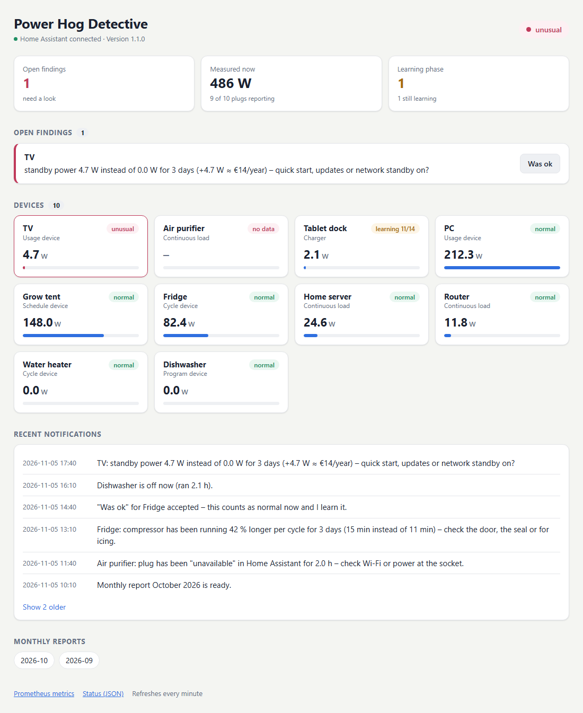

# Power Hog Detective

*Deutsche Fassung: [README.de.md](README.de.md)*

Learns the normal consumption pattern of every device behind a metering smart plug in Home Assistant and reports unusual behaviour **with a plain-language explanation**:

> Fridge: compressor has been running 42 % longer per cycle for 3 days (15 min instead of 11 min) – check the door, the seal or for icing.

> Night base load +36 W since Sunday, not attributable to any plug (136 W instead of 100 W without a metering plug, ≈ €108/year) – check devices without a metering plug …

> Dishwasher has been running continuously for 5.0 h (configured limit 5.0 h) – forgot to switch it off?

Everything at a glance in a small web UI ([more](#web-ui-and-http-api)):



*Demo data, not a real household.*

Notifications, web UI, reports and Home Assistant sensor states are available in **English and German** (`language: en | de`).

The detective is **read-only**. It never switches a device:
- Every Home Assistant service except `notify.*` and `persistent_notification.*` is blocked in code, and a test checks this.
- It writes only its own sensors `sensor.<prefix>_*`.
- Once, it creates a feedback script `script.<prefix>_was_ok`.

---

## Contents

1. [What it detects](#what-it-detects)
2. [How it learns](#how-it-learns)
3. [Requirements](#requirements)
4. [Installation](#installation)
5. [Secrets](#secrets)
6. [Configuration](#configuration)
7. [Using it: notifications, "Was ok", CLI](#using-it)
8. [Web UI and HTTP API](#web-ui-and-http-api)
9. [Home Assistant, Prometheus, Grafana](#home-assistant-prometheus-grafana)
10. [Monthly report](#monthly-report)
11. [Data and SD card](#data-and-sd-card)
12. [Tests and acceptance scenarios](#tests)
13. [Troubleshooting](#troubleshooting)
14. [Limits](#limits)

---

## What it detects

| Device type | Examples | Learned daily features | Typical finding |
|---|---|---|---|
| `cycle` | fridge, water heater | cycle length, pause, cycles/day, share of running time, kWh | longer cycles → door/seal/icing; heater reheats more often → hot water use, dripping tap |
| `continuous` | router, server, Raspberry Pi | base load (median) | base load +9 W since Tuesday |
| `program` | dishwasher, washing machine | recognises programs (duration + energy), runs, standby | Program A has needed 50 % more energy for 2 runs → scaled heating element? |
| `usage` | PC, TV | standby power, hours on | standby 4.7 W instead of 0 W → quick start/updates? |
| `charger` | tablet dock | power without charging, charges | draws power permanently without charging … |
| `schedule` | grow tent, aquarium | switch-on time, power while running | switches on at 07:00 instead of 06:00 → timer? |
| house | whole-house meter (optional) | night base load, share without metering plug, large load peaks (instantaneous water heater) | night base load +36 W, not attributable to any plug |

**Live checks**, every 30 seconds:

- **Runs unusually long** (the iron case). The limit is either `max_runtime` per device or learned (longest usual run × 1.2 or 99th percentile × 1.5). For a fridge: "compressor running without a pause → door open?"
- **Suddenly draws nothing** although the plug is on, which points to a defect:
  - continuous loads: after 15 min,
  - cycle devices: when the longest usual pause is exceeded three times over.

  A plug switched off on purpose never alerts.

**Self-monitoring:**

- **Plug unavailable** (`unavailable`/`unknown` in HA, the connection is lost): push notification after 30 min.
- **Plug sends no fresh values** but is connected: shown quietly in the web UI only. Rarely used devices (e.g. a dishwasher) would otherwise keep alerting. Set `notify_no_data: true` to push these too.
- **Home Assistant unreachable:** the notification is buffered and sent once HA is back.
- **Entity renamed:** detected via the `unique_id`, followed automatically and reported.
- **Entity missing.**
- **House data missing or implausible** (house below the sum of the plugs).

**Liveness:** Home Assistant does not refresh `last_reported` of a power sensor while its value stays the same. The detective therefore watches a sibling sensor of the same device (usually the voltage) and finds it automatically in the entity registry.

## How it learns

- **At least 14 days** of learning (`learning.min_days`); no comparison alerts before that.
- **Sliding 28-day window** (`learning.window_days`): the normal is the median of the last 28 valid days. Slow, intended changes become the normal and never alert.
- **Noise suppression:** a day counts as unusual when it differs from the normal by all of the following:
  - at least 25 %,
  - at least 3 robust standard deviations (MAD),
  - a minimum size (e.g. 2 min cycle length, 3 W base load).

  An alert needs **3 days in a row** (`detection.stable_days`). Harmless directions (less consumption, longer pauses) never alert.
- **New normal:**
  - "Was ok" makes the new behaviour normal at once: comparison restarts at the beginning of the deviation and needs 3 days.
  - Without feedback this happens automatically when a deviation lasts 14 days, with a short notice.
- **All clear:** after 2 normal days a finding is resolved; optionally "… is back to normal" is sent.
- **Pre-learning from the past:** `sfd prelearn` uses three sources:
  - 35 days from Prometheus via HA's Prometheus exporter, every 15 s, fine enough for compressor cycles,
  - the HA recorder as a fallback,
  - hourly HA long-term statistics for the reports.

  Old entity ids (before a rename) go under `history:` per device.

## Requirements

- Home Assistant with power sensors in W for each smart plug (tested with TP-Link/Tapo P110 via the `tplink` integration). A switch entity per plug is optional; it tells "switched off" apart from "defect".
- A notify service, e.g. the companion app `notify.mobile_app_<phone>` (for the "Was ok" button).
- Docker with the Compose plugin (tested on a Raspberry Pi 4, arm64).
- Optional:
  - Prometheus scraping HA (`prometheus:` integration), for pre-learning,
  - Grafana,
  - a whole-house meter in HA (IR reading head on the electricity meter, Shelly 3EM, …).

## Installation

```bash
git clone https://github.com/Zedas030/power-hog-detective.git /opt/power-hog-detective
cd /opt/power-hog-detective
cp config/config.example.yaml config/config.yaml   # adjust, see "Configuration"
cp .env.example .env && chmod 600 .env              # put the token in, see "Secrets"
mkdir -p data && sudo chown 10001:10001 data         # the container runs as user 10001
docker build --target test -t power-hog-detective:test .        # runs all tests
docker compose run --rm power-hog-detective selftest            # connection + entities
docker compose run --rm power-hog-detective prelearn            # read history (about 5 min)
docker compose up -d --build
```

What `docker-compose.yml` sets up:

- Autostart (`restart: unless-stopped`).
- Limits: 256 MB RAM, 0.5 CPU, 64 processes.
- Read-only root filesystem, no capabilities.
- Log rotation: 3 × 10 MB.
- Host network, so the container reaches HA and Prometheus on `127.0.0.1`.
- Healthcheck on `/health`.

Then open the web UI at `http://<host>:8101/`, see [Web UI and HTTP API](#web-ui-and-http-api).

To update: `git pull && docker compose up -d --build`. Data and everything learned stay in `data/`.

## Secrets

| What | Where | Notes |
|---|---|---|
| Home Assistant token | `.env` next to `docker-compose.yml` → `HA_TOKEN=…` | file `chmod 600`, never in `config.yaml`, never commit it |

**Create or rotate the token:**

1. In HA open your profile (bottom left) → tab *Security* → *Long-lived access tokens* → *Create token*, e.g. named `power-hog-detective`.
2. Put it into `.env` after `HA_TOKEN=` (the file stays `chmod 600`).
3. Run `docker compose up -d` (the container reads `.env` on start).
4. Check: `docker compose exec power-hog-detective python -m sfd selftest`.
5. Delete the old token in HA under *Long-lived access tokens*.

The token needs read access to states, registry, history and statistics and must be allowed to call `notify`. HA has no read-only tokens; the protection against switching lives in the detective itself.

## Configuration

Everything is commented in [`config/config.example.yaml`](config/config.example.yaml). The important parts:

```yaml
language: en                          # en | de
home_assistant:
  notify: notify.mobile_app_phone     # notifications with a "Was ok" button
prices:
  import_eur_kwh: 0.34
  export_eur_kwh: 0.00
devices:
  fridge:
    name: Fridge
    type: cycle                       # cycle | continuous | program | usage | charger | schedule
    profile: fridge                   # fitting tips in the messages
    power: sensor.fridge_power
    switch: switch.fridge             # so that "off" is not taken for a defect
  iron:
    name: Iron
    type: usage
    power: sensor.iron_power
    max_runtime: 45m                  # the iron case
```

Add a device and run `docker compose restart`. It starts learning at once, and with `prelearn` also from the past.

**Whole-house meter:** under `house:` set a power sensor for the whole house, e.g. from an IR reading head or a Shelly 3EM. This enables:
- night base load of the house,
- load that no plug sees,
- grid/solar share,
- the instantaneous water heater estimate.

Without a meter this part sleeps. The solar share is then estimated from `solar_into_house` (e.g. the output power of a battery/micro inverter running zero export).

German keys from earlier versions (`geraete`, `typ: zyklus`, …) keep working as aliases.

## Using it

**Notifications** go to the configured `notify` service. On the phone every finding has a **"Was ok"** button.

**"Was ok" (feedback)** works in four ways. The detective then learns the new behaviour as normal.

| Way | How |
|---|---|
| Phone | "Was ok" button in the notification |
| HA action | `script.<prefix>_was_ok` with `device: Fridge` (name or key, `House` for the house) and optional `note`. Use it in dashboards and automations. Alternatively fire the event `<prefix>_feedback` yourself. |
| Web UI | "Was ok" button next to the finding |
| CLI | `docker compose exec power-hog-detective python -m sfd ok <id or device> --note "…"` |

What "Was ok" does:

- **Daily features:** the new normal starts at the beginning of the deviation.
- **Programs:** the deviating runs become the program.
- **"Runs too long":** the limit rises to the observed runtime × 1.5.
- **Outages** ("no values", "0 W"): muted until the problem is over; after that the finding can alert again.

**CLI** (inside the container: `docker compose exec power-hog-detective python -m sfd …`):

| Command | Purpose |
|---|---|
| `status` | learning progress, yesterday's features, open findings |
| `findings` | recent findings with id and state |
| `ok <id/device>` | feedback "Was ok" |
| `prelearn [--days 35] [--notify]` | learn from Prometheus/HA history |
| `report [--month 2026-10] [--send]` | write a monthly report (and send the summary) |
| `scenario compressor\|baseload\|runtime\|all [--send]` | acceptance scenarios, see below |
| `import-statistics` | reload hourly statistics from HA |
| `selftest` | check token and entities |

## Web UI and HTTP API

`http://<host>:8101/` is a dashboard for a quick look, on the desktop or the phone:

- **Header:** overall status (`ok`, `learning`, `unusual`, `disconnected`) and whether Home Assistant is connected.
- **Key figures:** open findings, power measured right now across all plugs (and how many plugs are reporting),
  devices still in the learning phase. With a whole-house meter there is also a tile for the house.
- **Open findings** as cards with the device name and a **"Was ok"** button.
- **Devices** as tiles with live power, a bar relative to the strongest device and their state
  (`normal`, `learning n/14`, `unusual`, `no data`). Problems come first, then the devices by power.
- **Recent notifications** as a timeline: the latest 6, up to 30 more on click.
- **Monthly reports** as links.

The page follows the light/dark setting of the system, uses two columns on phones and reloads every minute while
the tab is visible. It loads nothing from the internet.

**HTTP endpoints** (same port):

| Path | Purpose |
|---|---|
| `GET /` | the dashboard above |
| `GET /reports/report-YYYY-MM.html` | a monthly report |
| `GET /api/status` | JSON: `status`, learning progress per device, open findings with `id`, `device`, `message`, `state` |
| `POST /api/feedback` | "Was ok" from your own tools: JSON `{"target": "<finding id or device>"}`, answers `{"accepted": [ids]}` |
| `GET /metrics` | Prometheus metrics, see below |
| `GET /health` | JSON `ok`, `ha_connected`, `version`, `uptime_s` (used by the Docker healthcheck) |

Example: `curl -X POST -H 'Content-Type: application/json' -d '{"target": "TV"}' http://<host>:8101/api/feedback`

**There is no login.** Anyone who reaches the port can see the devices and press "Was ok". Keep port 8101 inside
your LAN or VPN and do not forward it on the router.

## Home Assistant, Prometheus, Grafana

**HA sensors** are set every minute and after each HA restart. Names shown with `language: en`; with `de` they are German.

- `sensor.<prefix>_status`: `ok` / `learning` / `unusual` / `disconnected`, attribute `open_findings`.
- `sensor.<prefix>_open_findings`: count.
- `sensor.<prefix>_<device>`: `normal` / `learning` / `unusual` / `no data`. Attributes: device type, learning days, current finding, yesterday's features.
- With a house meter also `sensor.<prefix>_night_base_load` and `sensor.<prefix>_unassigned_base_load`.

**Prometheus:** `http://<host>:8101/metrics`. Scrape config:

```yaml
  - job_name: power_hog_detective
    scrape_interval: 60s
    static_configs:
      - targets: ['localhost:8101']
```

Metrics (`sfd_…`):

- `device_power_watts`
- `device_last_value_age_seconds`
- `device_available`
- `device_running_seconds`
- `feature_value` / `feature_baseline` (feature against the learned normal)
- `learning_days`
- `anomalies_open`
- `house_night_base_watts`
- `ha_connected`
- `outbox_pending`
- `db_size_bytes`

**Grafana:** import [`grafana/power-hog-detective.json`](grafana/power-hog-detective.json) or put it into a provisioning folder. The data source is a variable. Regenerate it with `python grafana/make_dashboard.py`.

## Monthly report

On the 1st of every month at 07:00 (configurable) the detective writes `data/reports/report-YYYY-MM.html` (also linked in the web UI) and sends a summary via `notify`. The report contains:

- **Consumption and cost per device.** Cost = kWh × grid share of that hour × price.
- **Solar/battery share versus grid:** measured with a house meter, otherwise estimated.
- **Base load trend** over the month.
- **Top 5 savings** in €/year with the calculation behind each. Possible items:
  - switch off standby,
  - usage devices running at night,
  - fridge above a reference value,
  - move flexible loads into sunny hours,
  - unassigned base load,
  - instantaneous water heater.
- **Findings of the month and notes on the data.**

By hand: `python -m sfd report --month 2026-10`.

## Data and SD card

SQLite in `data/` (WAL mode). Readings are collected and written in one batch per minute.

The daily evaluation runs at 00:20 and then condenses the data:

| Tier | Kept (configurable under `storage:`) |
|---|---|
| raw readings | 14 days |
| minute averages | 90 days |
| 15-minute averages | 2 years |
| hourly energy, daily features, runs, findings | forever (a few MB per year) |

Size after pre-learning 35 days of 12 plugs: about 85 MB, then roughly stable.

## Tests

```bash
docker build --target test -t power-hog-detective:test .     # unit and end-to-end tests
pip install -r requirements.txt -r requirements-dev.txt && python -m pytest -q tests/
```

The test files:

- **`tests/test_detection.py`:** detection logic on synthetic consumption data. It covers compressor cycles, base load, runtime, defect, outage, feedback, slow drift, programs, schedules, plausibility and muting.
- **`tests/test_report.py`:** monthly report and metrics.
- **`tests/test_english.py`:** English texts, English and German config keys.
- **`tests/test_e2e.py`:** the real service against a fake Home Assistant (WebSocket + REST). It covers:
  - finding with button and button round trip,
  - entity rename,
  - silent plug and liveness via the voltage sensor,
  - missing house data and feedback via the HA event,
  - HA outage, web UI and metrics,
  - only `notify` services called.

**Acceptance scenarios on your real learned data.** They run on a copy of the database; with `--send` they arrive on the phone as `[TEST]`.

```bash
docker compose exec power-hog-detective python -m sfd scenario all --send
```

| Scenario | What happens |
|---|---|
| `compressor` | fridge cycles 40 % longer than learned for 5 days, then "Was ok" and 5 more days without a finding |
| `baseload` | simulated house meter on top of the real plug curves, +35 W without a metering plug after 16 learning days |
| `runtime` | a device with `max_runtime` runs past its limit and is switched off |

## Troubleshooting

| Problem | Check |
|---|---|
| No notifications | `docker logs power-hog-detective`. If `sfd_outbox_pending` > 0, HA does not accept `notify`. Run `selftest`. |
| "No values" in the web UI although the plug works | Look for the log line "Liveness sensor for …". If it is missing, set `liveness: sensor.<x>_voltage` for that device. |
| A device keeps "learning" | It needs 14 days with at least 80 % coverage; `status` shows where it stands. |
| Port in use | change `web.port` in `config.yaml` and the Prometheus target. |

## Limits

- **Without a whole-house meter** the house consumption, grid import, whole-house night base load and the water heater cannot be measured. The logic is complete and tested; it starts once a meter is set under `house:`.
- **The water-heater estimate** looks for large load peaks that no plug sees. It is good with meter values every few seconds and only rough with 5-minute values.
- **Program detection** pays off for appliances with recurring programs. For a 3D printer switch it off (`detect_programs: false`), because every print is different.

## License

MIT, see [LICENSE](LICENSE).
